# UI overhaul: audit and options (no site code changed)

Branch `ui-overhaul`. Written Sun 2026-11-15, ~10:30 NST. Main and production are untouched.

**Time check before anything else.** CLAUDE.md sets feature freeze at **12:00**, demo-ready at **16:00** and the deadline at **18:00**. A full overhaul (any direction) does not fit. The recommendation in sec. 6 is a phased, hash-compatible restyle with a hard stop: if it isn't verified on a preview by 15:30, production stays as it is now, and the current site is already judge-ready. Building anything at all means moving the 12:00 freeze, and that is your call.

Contents: 1 Audit · 2 Visuals (message, accuracy, effort, risk) · 3 Navigation · 4 Design system and motion · 5 Three directions with mockups · 6 Recommendation, schedule, cut list · 7 Constraint checklist · 8 How to reproduce.

---

## 1. Audit

**Method.** `node scripts/shots/audit.mjs https://flame-frontier.vercel.app docs/ui/audit` (read-only tooling, new on this branch). For each tab it loads the live site at 1440×900 and 375×812 (light, reduced motion, `?offline`). It saves the first viewport (`*-fold.jpg`) and the whole page (`*-full.jpg`, capped at 6000/9000 px), and counts **visible** words: text that is rendered, outside closed `
`, for the whole page and for the first viewport only. It also counts **hidden** words, meaning text already behind a closed `
`, and lists every text block with its word count (`audit/before/audit.json`). The counts include the header (title, tagline and 13 tab labels ≈ 35 words).

### 1.1 Numbers

| Tab | Desktop above fold | Desktop visible total | Hidden (in expanders) | Phone above fold | Phone page height | Visuals on the tab |
|---|---:|---:|---:|---:|---:|---|
| Start | 350 | 350 | 0 | 158 | 1 878 px | none (4 number tiles) |
| Evidence Map | 143 | 304 | 281 | 83 | 2 572 px | 2 charts, 1 image, 1 table |
| Flame Sandbox | 178 | 460 | 542 | 111 | 3 183 px | WebGL flame, 1 video |
| Catalog | 284 | 1 048 | 20 770 | 161 | 6 358 px | 24-slot strip, 25-row table |
| Ranking | 383 | 1 029 | 0 | 190 | 4 684 px | 2 tables (56 rows), thin score bars |
| Compare | 332 | 562 | 428 | 135 | 3 467 px | 1 table |
| Habitat Gaps | 317 | 765 | 443 | 151 | 3 846 px | none |
| Prevent · Detect · Suppress | 304 | **1 710** | 0 | 135 | **9 565 px** | none |
| Ask | 242 | 242 | 0 | 179 | 1 248 px | none |
| On Earth | 298 | 765 | 0 | 151 | 4 148 px | none |
| Clips | 421 | 456 | 0 | 155 | 2 608 px | 3 videos |
| Known Limits | 494 | **2 461** | 0 | 157 | **11 210 px** | 1 table |
| References | 222 | 1 157 | 0 | 129 | 7 943 px | 2 tables |

What the numbers say:
- **8 of 13 tabs have no chart, image or video at all.** Every non-chart tab is 300–2 500 words of prose and lists.
- Above the fold, desktop shows **140–500 words** per tab. A judge skimming for 5 seconds reads about 15–25 of them.
- Sources are written inline as prose. File paths, line numbers and page numbers make up roughly a fifth of the visible words on Gaps, Controls, Earth and Clips: e.g. `data/raw/PSI-25/PSI-25_Experimental table_BASS-II.csv, line 52` sits in the running text.
- **Duplication:** the Moon-base and rover blocks on Habitat Gaps are word-for-word identical (same window, ~200 words each). Controls repeats the same 4 Moon-base gap sentences. The headline sentence appears 4 times across Start, Evidence, Limits and Controls.
- **Phone:** Controls (9.6k px) and Limits (11.2k px) are 11–13 screens of scrolling. The 13-tab bar shows 3 tabs at a time.
- No horizontal overflow on any tab at either width, and no console errors. The current a11y work (focus rings, skip link, roving tabindex) is solid and must survive.

### 1.2 Per tab: the 5-second message and each block's fate

KEEP = short, essential. SHORTEN = new wording given. SHOW = replaced by a visual or interaction. HIDE = moved behind a source chip, an ⓘ, an expander or a drawer (still one interaction away). Nothing in the HIDE column is deleted.

<table><tr><td>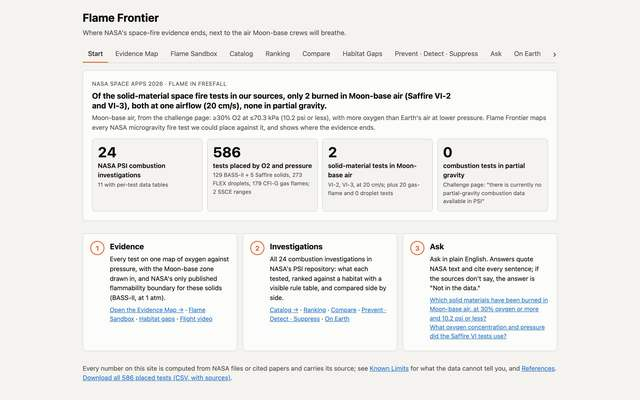</td><td>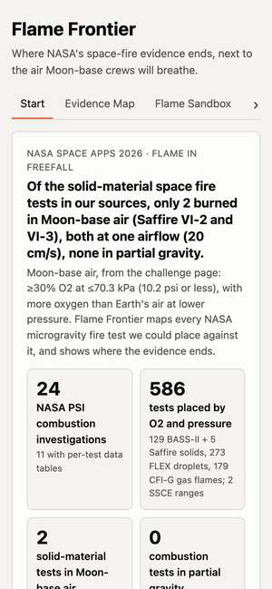</td></tr></table>

**Start.** *5 s: "Only 2 solid tests ever burned in Moon-base air."* Target ≤ 80 words above the fold (now 350).
| Block | Now | Fate |
|---|---|---|
| Eyebrow "NASA Space Apps 2026 · Flame in Freefall" | 7 w | KEEP |
| Headline | 29 w | KEEP, exact template wording (mandated) |
| "Moon-base air, from the challenge page: ≥30% O2… shows where the evidence ends." | 43 w | SHOW: the window becomes the Moon bin's label in the dot chart ("≥30% O2 · ≤70.3 kPa" + chip `challenge page`); the mission sentence goes to About |
| 4 tiles, numbers + labels | 4–6 w each | KEEP the number + a 3–4 word label |
| Tile captions ("129 BASS-II + 5 Saffire solids, 273 FLEX…") | 18–22 w each | HIDE: hover/focus popover. The 586 breakdown becomes a stacked bar inside the popover |
| 3 entry cards (Evidence / Investigations / Ask) | 24–28 w each + link rows | SHORTEN to 3 buttons: **See the evidence →**, **Explore the 24 →**, **Ask →** |
| 2 sample questions | 30 w | HIDE: they live on Ask |
| Footnote "Every number on this site is computed…" | 37 w | SHORTEN: "Every number has a source. ↓ Data (CSV) · Known limits" |
| *(new)* | | SHOW: the 134 solid tests as dots in 4 crew-air bins (V1) |

<table><tr><td>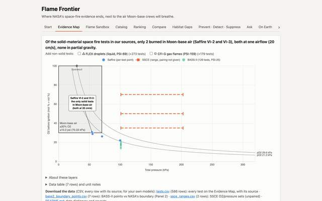</td><td>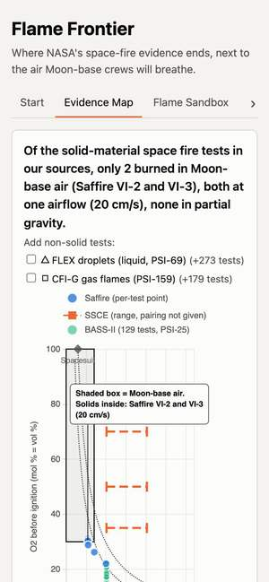</td></tr></table>

**Evidence Map.** *5 s: "The Moon-base box is dark and nearly empty."* Already chart-first; the text is below the charts.
| Block | Now | Fate |
|---|---|---|
| Headline | 29 w | KEEP (exact) |
| "Add non-solid tests: ☐ FLEX… ☐ CFI-G…" | 14 w | SHORTEN to pills: `+ FLEX droplets 273` `+ CFI-G gas 179` |
| ECharts legend (3 series) | 15 w | KEEP, plus direct labels on the chart ("129 BASS-II tests, all at 1 atm", "SSCE: O2 and pressure listed, not paired") |
| Callout in the zone | 14 w | KEEP; on hover the zone shows "what's missing" (V2) |
| About these layers / Data table | closed | KEEP closed (already HIDE) |
| "Download the data (CSV…): tests.csv (586 rows)… README.md" | 50 w | SHORTEN to one button **↓ Data** whose menu lists the 4 files with row counts |
| Panel 2 lead paragraph (fit, tested a-range, computed min, report text) | 79 w | SHOW: the curve draws over the tested range, dashed beyond; regions labelled *Burns* / *Goes out: quenching* / *Goes out: blowoff*; chips `eq. 6.1 · p.75`, `min 13.61% at a = 10.38`, `tested a 4.75–182.95 1/s`. Full paragraph moves to HIDE (ⓘ) |
| "Only 7 of NASA's ~50 ISS boundary points can be reconstructed…" + 2 bullets | 52 w | SHORTEN: "7 of NASA's ~50 ISS points can be rebuilt from PSI. Why?" (expander keeps both bullets) |
| NASA Fig. 6.10 thumbnail + caption | 18 w | HIDE behind "Compare with NASA's figure" (image + caption unchanged) |

<table><tr><td>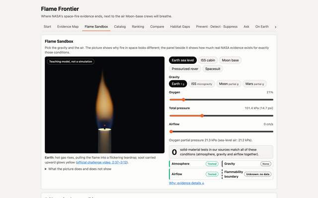</td><td>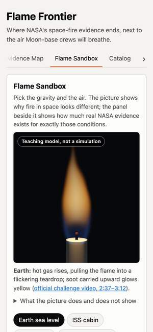</td></tr></table>

**Flame Sandbox.** *5 s: "In space a flame is a blue sphere; here's how much evidence exists for these settings."* Already the most visual tab.
| Block | Now | Fate |
|---|---|---|
| Intro "Pick the gravity and the air…" | 30 w | SHORTEN: "Pick gravity and air. Teaching model, not a simulation." (the second sentence is already a badge) |
| Flame caption (Earth / micro) | 22 w | KEEP (with video timestamp chip) |
| Verdict count + 4 badges | ~30 w | KEEP; the badges carry icons |
| Matching-test list ("52 solid tests within ±2 points…: Saffire IV-1, BASS-II B1…") | 42 w | SHORTEN: "52 solid tests nearby ›" (the list moves into a drawer) |
| `Source:` lines | 13–20 w each | HIDE into chips |
| Flow sentence listing every recorded flow | 34 w | SHOW as a tick strip of recorded flows, with your flow marked |
| Nearest-clip block | 54 w | SHORTEN to a thumbnail + "Nearest filmed test: O1 · 22.2% O2 · differs in gravity" |

<table><tr><td>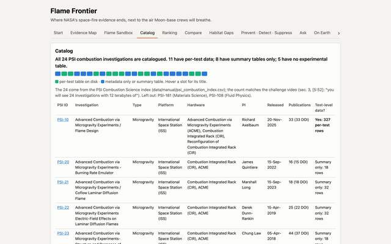</td><td>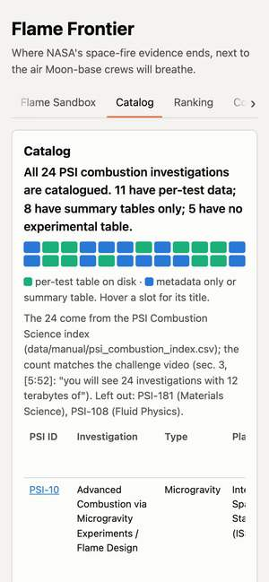</td></tr></table>

**Catalog.** *5 s: "24 NASA investigations; 11 have per-test data; these are the fire-safety ones."*
| Block | Now | Fate |
|---|---|---|
| "All 24 PSI combustion investigations are catalogued. 11 have per-test data; 8…; 5…" | 21 w | KEEP |
| 24-slot strip + legend | 14 w | SHOW: replaced by the tile grid (V6) |
| Index provenance sentence (psi_combustion_index.csv, video 5:52) | 40 w | HIDE into chip `psi_combustion_index.csv · matches video 5:52` |
| 9-column, 25-row table | ~700 w | SHOW the tile grid by default; **table view** is one toggle away (unchanged) |
| 24 detail expanders (20 770 words of metadata) | hidden | KEEP as a drawer that opens on tile click |

<table><tr><td>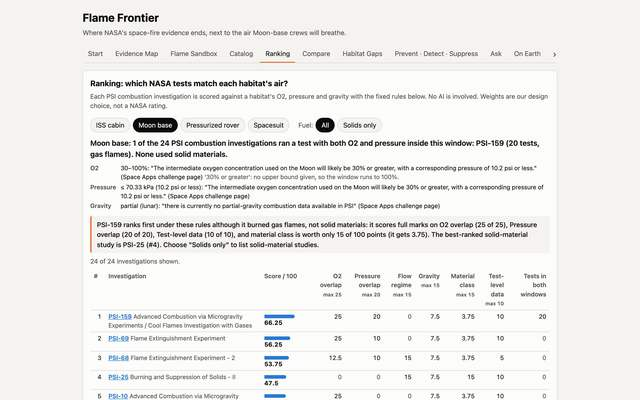</td><td>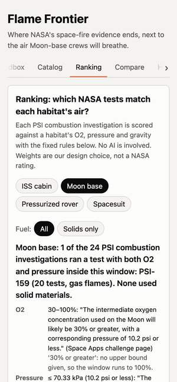</td></tr></table>

**Ranking.** *5 s: "For a Moon base, the best match is a gas-flame study; the best solid study is only #4."*
| Block | Now | Fate |
|---|---|---|
| Intro "Each PSI combustion investigation is scored…" | 31 w | SHORTEN: "Scored by fixed rules, not AI. Weights are our choice." |
| Habitat buttons + Fuel filter | | KEEP |
| Window headline "Moon base: 1 of the 24… PSI-159 (20 tests, gas flames). None used solid materials." | 29 w | KEEP |
| O2 / Pressure / Gravity quotes (dl) | 90 w | HIDE: the window line becomes 3 chips ("≥30% O2", "≤70.3 kPa", "partial g"); each chip opens its challenge-page quote |
| "Why it ranks first" callout | 61 w | SHORTEN: "#1 is a gas flame (PSI-159): full O2 and pressure marks. Best solid: PSI-25, #4." The stacked bar (V4) shows the rest |
| Score table (6 numeric columns) | ~450 w | SHOW: stacked component bars; numbers in tooltips; **table view** toggle keeps the current table |
| Rule table + note | 32 w + table | KEEP, collapsed under "How scores work" |

<table><tr><td>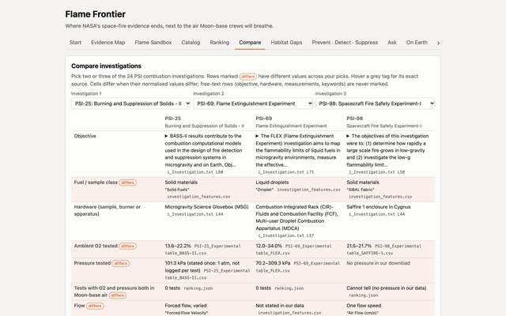</td><td>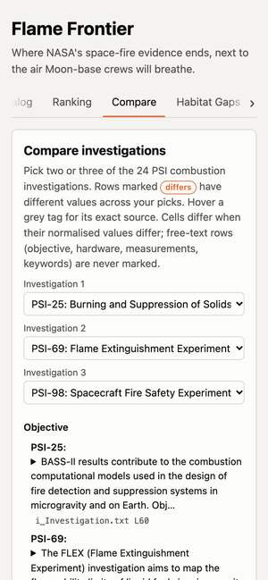</td></tr></table>

**Compare.** *5 s: "These three tested different air, and none reached Moon-base air."*
| Block | Now | Fate |
|---|---|---|
| Intro "Pick two or three… Hover a grey tag…" | 43 w | SHORTEN: "Pick 2–3 investigations. Differences are highlighted." |
| 3 selects | | KEEP |
| O2 / pressure / Moon rows | ~60 w | SHOW: range bars on shared axes with the Moon window shaded (V7); the text cells stay in the table below |
| Objective / measurements / keywords (collapsed) | hidden | KEEP collapsed |
| Grey source tags | | KEEP, restyled as chips |

<table><tr><td>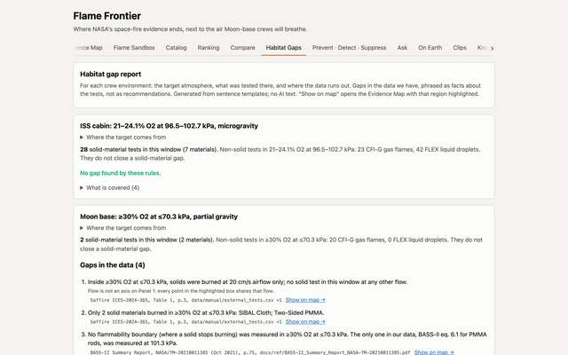</td><td>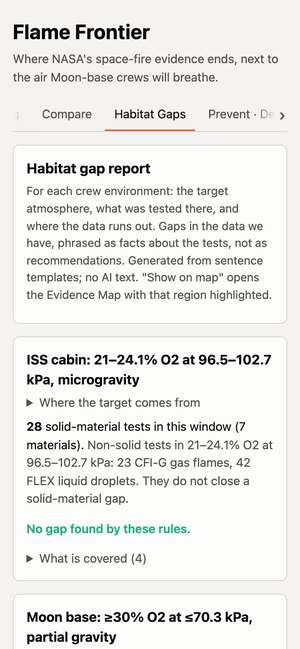</td></tr></table>

**Habitat Gaps.** *5 s: "ISS is covered; Moon base and rover miss 4 of 5; spacesuit has no solid test."*
| Block | Now | Fate |
|---|---|---|
| Intro | 50 w | SHORTEN: "Where the data runs out, per crew habitat. Template sentences, no AI." |
| 4 habitat cards (each: window, tested sentence, gap list with source lines) | ~650 w | SHOW: one coverage strip, 4 rows × 5 rules (V5). Moon base and rover share one row because the window is the same; rover is named in the row label |
| Gap sentences (26–63 w each) + source lines | | HIDE: click a cell → drawer with the exact sentence, source chips and "Show on map →" |
| "Where the target comes from" / "What is covered" | hidden | KEEP in the drawer |

<table><tr><td>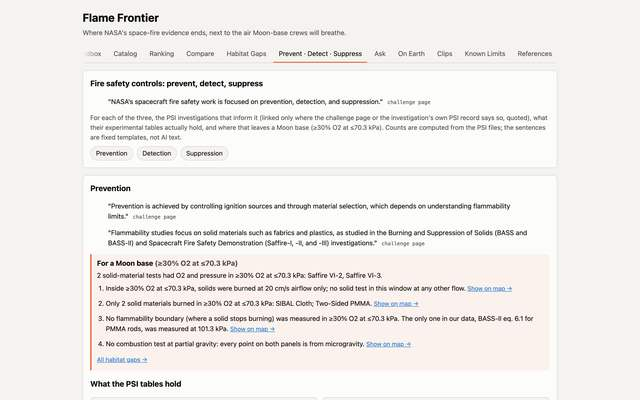</td><td>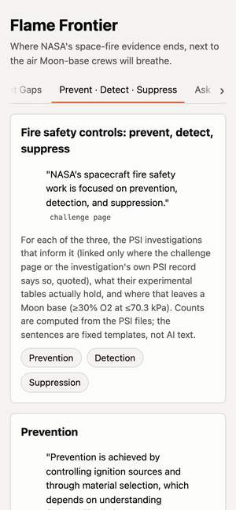</td></tr></table>

**Prevent · Detect · Suppress.** *5 s: "Each of NASA's 3 fire-safety roles has PSI evidence, and none of it is in Moon-base air."* The longest real-content tab (1 710 words, 9.6k px on a phone).
| Block | Now | Fate |
|---|---|---|
| Lead quote "…prevention, detection, and suppression." | 14 w | KEEP |
| Method paragraph | 59 w | SHORTEN: "Linked only where NASA's own words say so." + ⓘ |
| Role switcher | | KEEP (becomes 3 icon cards: shield / eye / extinguisher) |
| Role quotes (2 per role) | 19–35 w | KEEP the first quote per role; HIDE the second |
| "For a Moon base…" 4-item gap list (repeats Gaps) | ~110 w | SHOW: the Moon-base row of the coverage strip (V5), linked |
| Counted facts (134 solids, 14 materials, 1 boundary; 109+8 smoke tests, 0 O2 columns; 172 FLEX with suppressant…) | ~400 w | SHOW: stat tiles, each with a `0 in Moon-base air` badge; for Suppress, a mini O2-vs-pressure plot of the 172 FLEX suppressant tests with the Moon window shaded (empty) and test 92 labelled (V9) |
| Investigation lists ("its PSI record says: '…'") | ~600 w | HIDE: name + role icon; the quote moves to a drawer with its field/line chip |

<table><tr><td>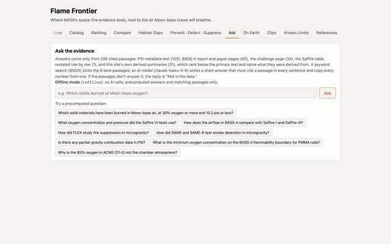</td><td>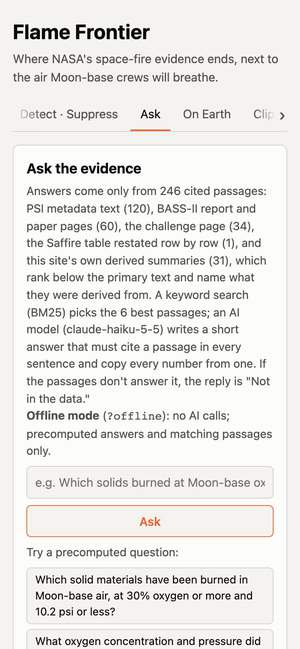</td></tr></table>

**Ask.** *5 s: "Ask a question; every sentence of the answer cites NASA."*
| Block | Now | Fate |
|---|---|---|
| Explainer (246 passages, counts per kind, BM25, model, offline mode) | 105 w | SHORTEN: "Answers quote NASA sources; every sentence cites one. Works offline." Corpus counts and method go to ⓘ |
| Input + 8 question chips | | KEEP |
| *(answers)* | | KEEP; citations render as chips (the same component everywhere) |

<table><tr><td>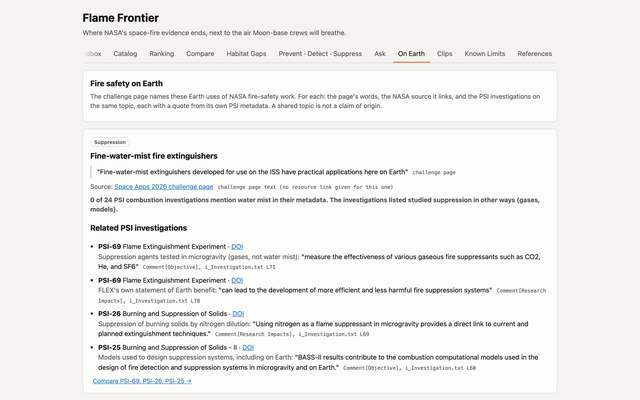</td><td>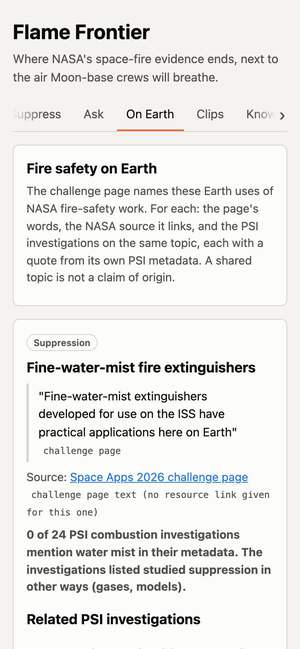</td></tr></table>

**On Earth.** *5 s: "4 everyday technologies the challenge names, and which PSI studies share the topic."*
| Block | Now | Fate |
|---|---|---|
| Intro | 47 w | SHORTEN: "Earth uses the challenge names. A shared topic is not a claim of origin." |
| 4 sections (quote, Spinoff source, counts, related investigations with quotes) | ~650 w | SHOW: 4 icon cards (mist, detector, air tank, clothing), each with a one-line challenge quote, a Spinoff link chip, and "Related PSI: 4" or "No PSI link"; the investigation quotes go into the card's drawer |
| "0 of 24 mention water mist" | 22 w | KEEP as the card's number |

<table><tr><td>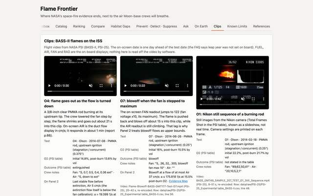</td><td>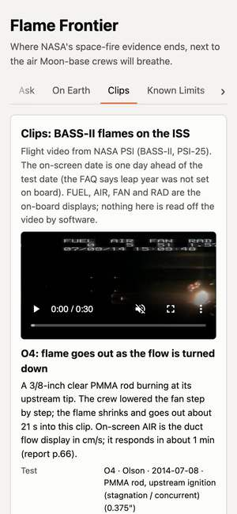</td></tr></table>

**Clips.** *5 s: "Real ISS footage: watch a flame go out as the airflow drops."*
| Block | Now | Fate |
|---|---|---|
| Intro (leap-year note, on-board displays) | 46 w | SHORTEN: "BASS-II flight video (PSI-25, CC0)." Leap-year note → ⓘ on the date |
| Per-clip paragraph | 27–47 w | SHORTEN to one line, e.g. "O4: flow turned down step by step → flame goes out (~21 s)" |
| dl (Test, O2, Outcome, Crew notes, On Panel 2) | ~60 w each | SHOW crew notes as the step strip (V8); the rest goes in an expander |
| `Video: …mp4 … Row: …csv, line 52` | 13–20 w | HIDE into chips |

<table><tr><td>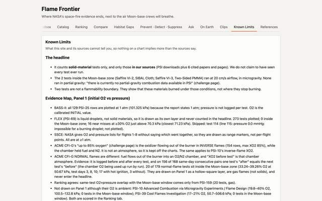</td><td>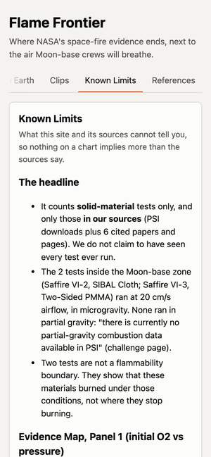</td></tr></table>

**Known Limits.** *5 s: "Here is exactly what this site cannot tell you."* It must stay present and complete.
| Block | Now | Fate |
|---|---|---|
| Intro | 20 w | KEEP |
| ~45 bullets in 7 groups (16–104 w each) | ~2 300 w | SHORTEN each to a one-line claim (bold) with the current text in an expander under it, word for word. Add a group index at the top (7 chips) and a "Whose oxygen?" table, already a table |
| | | Nothing is removed; this tab gets *more* findable, not shorter in substance |

<table><tr><td>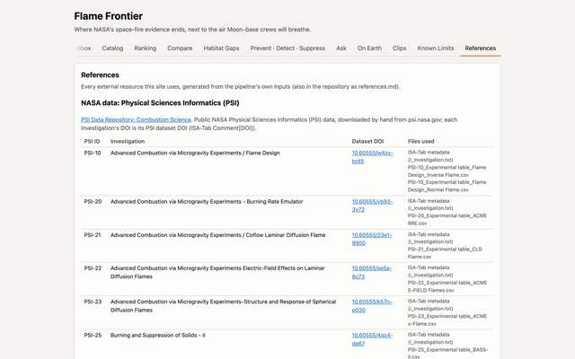</td><td>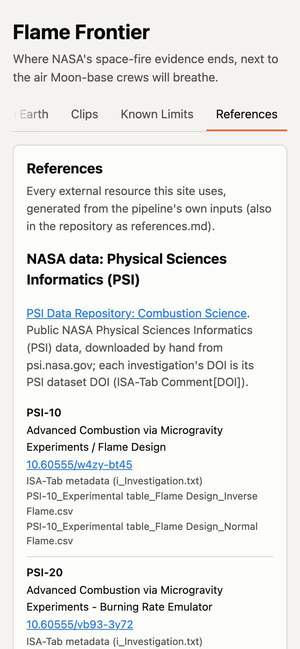</td></tr></table>

**References.** *5 s: "Everything we used, with links and licences."* A reference list is supposed to be text. KEEP. Group it into NASA data / papers / software / AI with icons, collapse the licence table, and keep the download link.

---

## 2. Visuals: what each one says, why it is accurate, effort, risk

Effort is my build time, including light/dark, 1440/375, keyboard and reduced motion. Risk is risk to the demo.

| # | Visual | Message in 5 s | Why it is accurate | Effort | Risk |
|---|---|---|---|---|---|
| V1 | **Dot bins** (Start hero). The 134 solid tests as dots that fall in and settle into 4 crew-air bins: *No crew-air window 104 · ISS cabin 28 · Moon base & rover 2 · Spacesuit 0* | "Almost everything was tested somewhere else; Moon-base air has 2 dots." | 1 dot = 1 row of `export/tests.csv` (fuel_state = solid). Bins are the habitat windows in `gaps.json`, inclusive, the same rule as Panel 1; the 4 counts sum to 134 and are computed, never typed. Moon base and rover share one bin because the brief gives them the same window, and the label says so. A test in no window goes to "No crew-air window" (102 BASS-II below 21% O2 at 1 atm, plus Saffire V-2 and VI-4, which are near misses; the hover says so). SSCE has no dots because its pairs are not given; a chip says "+2 SSCE range sets, unpaired, all ≥1 atm". Unit chart: no area or radius scaling. Animation ends in exactly the static layout; reduced motion shows the end state only. Hover/focus a dot → test ID + source row. Bins are focusable and announce their counts; table view available. Non-solids are behind a toggle (a separate row of hollow shapes) so the solid headline stays clean. | 2 h | Low (plain SVG, no library) |
| V2 | **Atmosphere map** (Panel 1). Same scatter, made editorial: the Moon zone is a dark, empty block; hovering it lists what's missing; direct labels replace legend reading | "The dark box is where crews will live, and it's nearly empty." | Same data, axes and units as now (O2 % vs total kPa, linear; x-max still data-driven). "What's missing" comes from the 4 gap rules in `gaps.json` (flow 20 cm/s only, 2 materials, no boundary, no partial g), each with its chip. **Rejected: a glowing density "heatmap"** for the default solids view. A KDE invents density between tests and its look depends on the bandwidth; 129 of 134 solids sit on one vertical line (1 atm), so a glow would smear a line into a cloud. With the +FLEX/+CFI-G layers on (586 tests) an optional **count grid** is honest: each cell = the count of tests in that O2×pressure cell, empty cells blank, one-hue sequential scale with a legend. | 1.5 h | Low–med (touches the main chart; the phone callout placement must be re-checked) |
| V3 | **Panel 2 draws itself.** The U-curve draws left to right over the tested range, dashed beyond; regions shaded and labelled *Burns* / *Goes out (quenching, slow flow)* / *Goes out (blowoff, fast flow)*; the 7 points pop in; blowoff markers carry a ◂ arrow | "A solid burns above the U and goes out below it, both at too little and at too much flow." | Eq. 6.1 exactly as now; log-x **labelled "log scale"**; y = post-burn O2 (axis label kept). The ◂ arrow makes "true a ≤ marker" (upper bound) visible instead of written. The region labels restate NASA's own fit (report sec. 6.1.4.4); shading is drawn full strength only over the tested a-range and fades beyond it, like the dashed curve. Computed minimum 13.61% shown as a chip; the report's "8 to 12 s⁻¹ at approximately 13.5%" stays quoted in the ⓘ. | 1.5 h | Low |
| V4 | **Ranking as stacked bars.** Each investigation's score split into its 6 rule components; switching habitat animates the reorder | "Why #1 is #1 is visible: it's the O2 and pressure blocks, and the solids lack them." | Segment widths = `points` from `ranking.json` parts, so bar length = score; bars start at 0 on a fixed 0–100 scale. Legend names each component with its max (25/20/15/15/15/10). Tooltip per segment = the rule text + the "why" string. Six colours are used **only adjacent in a stack**. Checked with the dataviz validator in this order (blue, orange, aqua, yellow, magenta, violet): all checks pass in light (worst adjacent CVD ΔE 9.1) and dark (8.4). In light mode, 3 of the colours fall below 3:1 against the surface, so the legend, the tooltips and the table view carry the labels, and each segment keeps a 2 px gap. The table view stays one click away. | 1.5 h | Low |
| V5 | **Coverage strip** (Habitat Gaps, reused in Controls). Rows = habitats, columns = the 5 gap rules, cells = ✓ covered / ✕ no data / n/a | "ISS: all green. Moon base and rover: 1 of 5. Spacesuit: no solid test." | Cells come straight from `gaps.json` rule ids; n/a is used only where a rule cannot apply (flow and material rules when no solid is in the window). Never colour alone: icon + word in each cell. Click a cell → the exact template sentence + chips + "Show on map". | 1 h | Low |
| V6 | **Catalog tiles.** 24 tiles, filled = per-test table, outline = summary only, dashed = no table; tile **area ∝ per-test rows** (side = √rows); P / D / S badges for prevention / detection / suppression | "11 investigations carry the test data, and these few are the fire-safety ones." | Area scaling is stated in the legend. Only the 11 investigations with per-test tables get a size; summary-only and none get a fixed small tile with no size meaning (said in the legend), because they have no test count. The label says "per-test rows", not "tests" (e.g. PSI-159's 333 rows span normal and inverse tables). **Adapted from your idea:** role is a *badge*, not the fill colour, because roles overlap (PSI-25 is in all three, PSI-26 in two, per `controls.json`). One fill colour per tile would be wrong. The table stays one click away. | 2 h | Med (replaces the default view of a whole tab) |
| V7 | **Compare range bars.** O2 and pressure for the 2–3 picks on shared axes, with the Moon-base window shaded | "BASS-II, FLEX and Saffire-I tested different air; none reaches the shaded box." | Ranges are read from the numeric `o2_range_pct` / `p_range_kpa` already in `ranking.json`, not parsed from text. A single stated value (BASS-II's "1 atm, stated once") is drawn as a tick, not a bar, and labelled as such. Missing data is the text "not in our data", never an empty bar. Axes are linear and start at 0. | 1.5 h | Low |
| V8 | **Clips step strip.** Under each clip, the crew-noted steps as equal chips: *Air 5 cm/s › pot 0.7 › pot 0.5 › pot 0.4 › pot 0.36 › ext ✕* | "You see the crew turn the flow down until the flame dies." | **Adapted from your idea:** a time-synced flow-vs-time strip is not honest. The PSI table has no timestamps, and the fan pot is a control setting in different units from Air (cm/s), so the chips are ordinal and equal-sized (no height or time encoding). Labels are factual: pots 0.4 and 0.36 are "< lowest calibrated (0.5)". The only time mark is the "~21 s" the clip caption already states. | 1 h | Low |
| V9 | **Suppressant mini-map** (Controls → Suppress). The 172 FLEX tests with CO2 or He, O2 vs pressure, Moon window shaded | "Suppressants were never tested in Moon-base air: the box is empty." | Points from `flex_tests.json` (same counts the tab states); test 92 (25% O2, 71.5 kPa, highest O2 with a suppressant) is labelled; same axes and units as Panel 1. | 1.5 h | Low |
| V10 | **Count-up numbers** on stat tiles | (emphasis only) | Counts from 0 to the final value in 600 ms, once. Screen readers and reduced motion get the final value immediately (`aria-label` holds the final number). | 0.5 h | Low |

Not proposed: any 3D chart, pies or donuts, radius-encoded magnitudes, dual axes. The Sandbox flame stays the one 3D element, and it is already labelled a teaching model.

---

## 3. Navigation: 13 tabs → 5 sections

| Section | Contains (sub-tabs as a pill row) | Why |
|---|---|---|
| **Story** | Start | The 5-second answer |
| **Evidence** | Map (Panels 1+2) · Sandbox · Clips | Everything that *shows* tests: points, flames, footage |
| **Explore** | Catalog · Ranking · Compare · Habitat gaps · Prevent·Detect·Suppress · On Earth | The 24 investigations, sliced 6 ways |
| **Ask** | Ask | Cited Q&A |
| **About** | Known Limits · References · Data (CSV) | Validity and provenance |

- **Every current hash keeps working** (`#evidence`, `#controls`, `#compare/PSI-25,…`, `#evidence/gap=…`, `#sandbox/…`, `#ask/…`). The section is derived from the tab id, so `demo.mjs`, the `SHOT_LIST.md` tour, Habitat-gap "Show on map" links and the OG card are unaffected.
- Desktop: 5 links in the header; sub-tabs as a pill row under the section title. Phone: a bottom bar with 5 items (44 px targets), with sub-tabs as a scrollable pill row. This replaces the 13-tab scroller.
- **Known Limits stays one click from every page**: an "ⓘ Limits" link in the header (desktop) and in the About item (phone), plus the footer line on every page. This satisfies "the Known Limits panel is always present".
- WAI-ARIA: the section nav is a `nav` with links (not tabs); sub-tabs keep the current roving-tabindex tablist pattern.

---

## 4. Design system and motion

**Type scale** (system UI stack, as now; no web font, which keeps Lighthouse): 12 / 13 / 15 (body) / 18 / 24 / 34 (headline, desktop) / 44 (hero numbers). Phone: headline 22, hero numbers 30. Weights 400 / 600 / 700; −0.02em letter-spacing at ≥ 24 px. Proportional figures on hero numbers, tabular in tables and axes (dataviz rule).

**Spacing**: a 4-pt scale (4, 8, 12, 16, 24, 32, 48, 64). Page gutter 56 desktop / 16 phone; max width 1200. Cards: radius 14, 1 px hairline border, no shadow (shadows only on popovers and drawers), padding 16 / 24.

**Colour tokens**: keep everything in `style.css` (surfaces, text, `--series-1..3`, accent, light + dark). Add:
- `--zone-strong` (#16161a light / #000 dark) for the "empty" Moon-base block, with `--zone-text` on it (contrast ≥ 7:1);
- `--hair` for borders a step lighter than `--grid`;
- status trio `--ok` / `--gap` / `--na` (only on the coverage strip, always with ✓ / ✕ / n/a text).
Any new categorical set (the 6 ranking components) is checked with the dataviz `validate_palette.js` in light and dark before it ships.

**Source chips** (one component everywhere, replacing inline `Source:` text and grey `.src` tags):
- A pill, monospace 11 px, short locator only: `Table 1 · p.3`, `BASS-II.csv L52`, `eq. 6.1 · p.75`, `challenge page`.
- It is a `<button>`: hover, focus or tap opens a popover with the full `cite()` text (document, section, page, file, row) and a link where one exists; Esc closes it.
- Rule: **every number on screen has a chip next to it or in the tooltip of the mark that shows it**, so a source is always one interaction away. Chart marks keep their tooltip sources as now.

**Icons**: about 10 inline SVGs (flame, droplet, gas, shield = prevent, eye = detect, extinguisher = suppress, moon, info, download, external). No icon font.

**Motion** (each animation runs once, when its block first enters view, and lasts ≤ 1.2 s; `prefers-reduced-motion: reduce` renders the final state with no transition):
- V1 dots fall and settle, so the reader sees the distribution form and the Moon bin stay nearly empty.
- V3 the curve draws, then the points appear, so the boundary is read before the points.
- V4 bars reorder on habitat switch (FLIP, 300 ms), so the reader can follow a row as it moves.
- V10 count-up, for emphasis only.
- Section change: 150 ms cross-fade.
- No looping motion except the existing Sandbox flame (already paused off-screen and still under reduced motion).

---

## 5. Three directions

Every mockup below is a static image rendered from the real `data/processed` files by `docs/ui/mockups/build.mjs`: every dot is a real test, and every count is computed. The live site is unchanged.

### A. Story-first scrollytelling
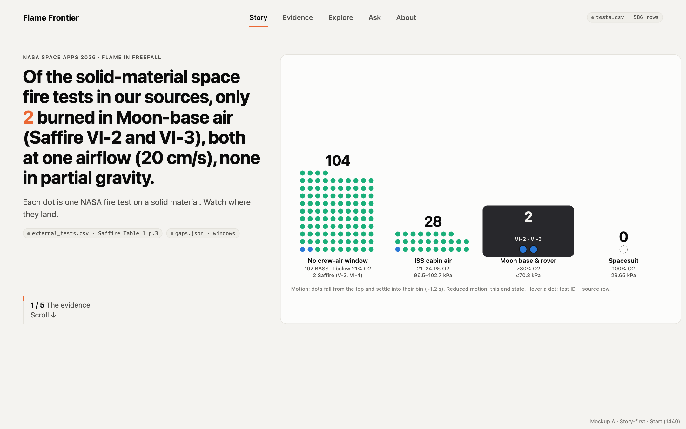 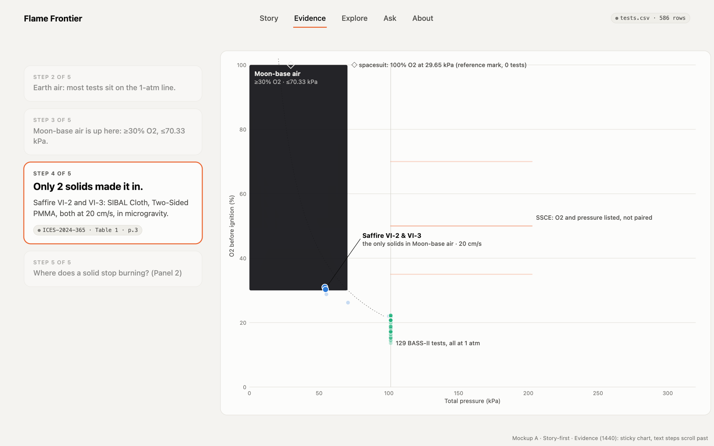

- **Look:** a full-screen narrative. Start = headline + the dot bins raining in. Evidence = a sticky chart on the right while text steps scroll past on the left (step 4 of 5 highlights the 2 in-zone tests; other points dim). Explore/Ask/About are conventional pages after the story.
- **Nav:** the 5 sections, plus a step progress rail on the story pages.
- **Motion:** heaviest, with scroll-driven chart states (dim, zoom, highlight).
- **Effort:** 14–18 h. **Risk: high.** Pinned charts on phones, ECharts re-layout per step, scrolly a11y (each step must also be readable without scrolling), and the demo tour and video stills all need re-doing.
- **Judging:** Presentation ++, Creativity ++, Impact + (strong narrative). Validity unchanged if done right, but most at risk of looking "designed over data".

### B. Mission dashboard (dark)
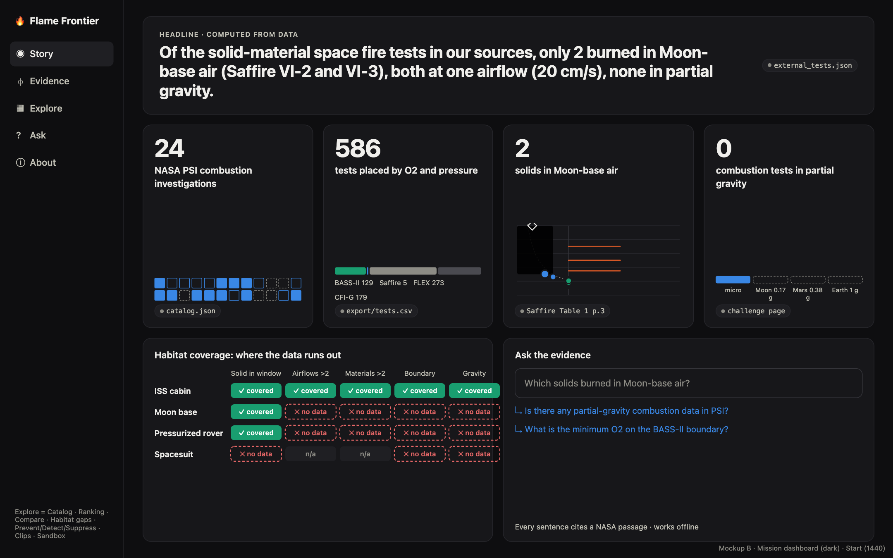 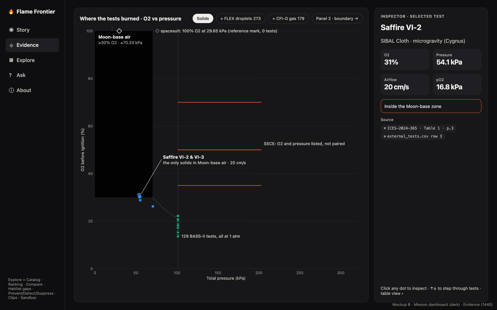

- **Look:** dark, sidebar nav, a bento grid of KPI cards each with a mini visual (24 squares, program stacked bar, mini map, gravity strip), the coverage strip, and an Ask card. Evidence = big chart + an **inspector drawer** for the selected test (values + source chips).
- **Nav:** 5 sections in a sidebar (desktop) / bottom bar (phone).
- **Motion:** light (count-ups, drawer slide).
- **Effort:** 10–12 h. **Risk: medium.** A new layout shell for every tab and a separate phone pattern for the drawer. Dark-first clashes with the light OG image and demo stills, and dark contrast needs re-checking.
- **Judging:** Presentation +, Creativity 0/+ (a dashboard is the expected genre), Impact + (scannable). The inspector is the best "source in one interaction" pattern of the three.

### C. Editorial data-journalism (recommended), with A's dot bins as the hero
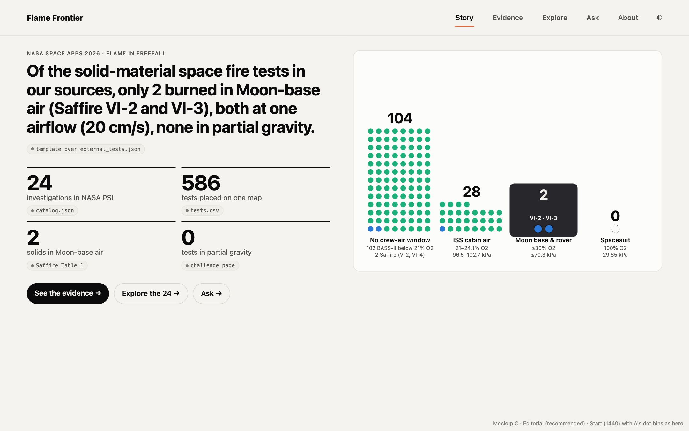 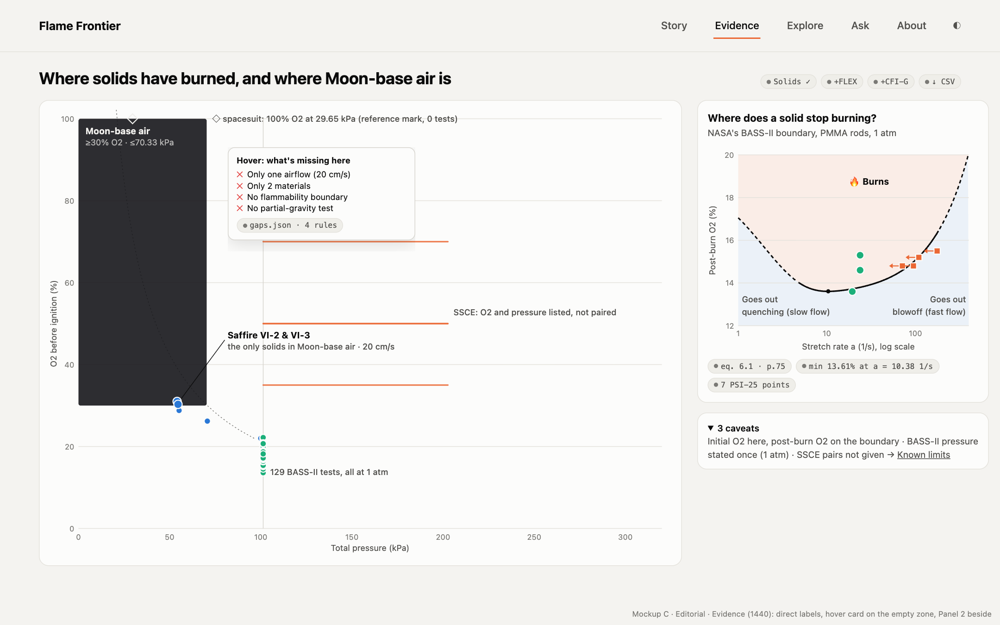

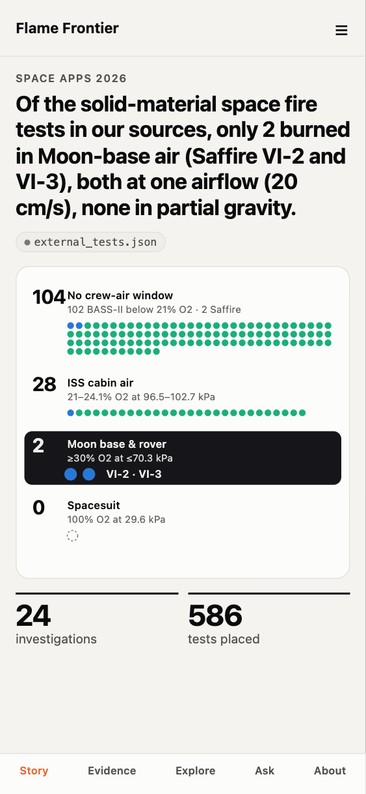 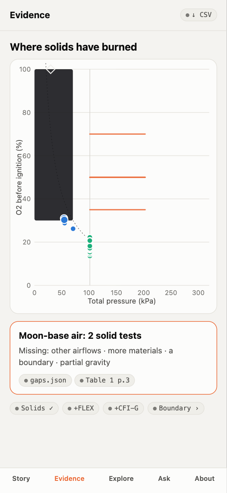

- **Look:** light, generous whitespace, one big picture per page, big headline, numbers with rules above them, source chips, direct labels on charts, captions instead of paragraphs. Start = headline + 4 numbers + 3 buttons, with the dot bins beside them. Evidence = Panel 1 with the dark empty zone and its "what's missing" hover card, and Panel 2 beside it with labelled regions. Caveats go in one collapsible card.
- **Nav:** 5 sections in the header; a bottom bar on phones.
- **Motion:** moderate and purposeful (V1, V3, V4, V10).
- **Effort:** 6–8 h for everything below; **core 4.5 h** (sec. 6). **Risk: low–medium.** It keeps the current page structure, tab modules, ECharts setup, hashes and light theme; most work is CSS, a chip component and per-tab text moves.
- **Judging:** Presentation ++ (clean, modern, skimmable), Impact + (the answer lands in 5 s on Start), Creativity + (dot bins, empty-zone hover, self-drawing U-curve, coverage strip), Validity = (every chip one click away; Limits untouched in substance).

### Visual gallery (works in any direction)
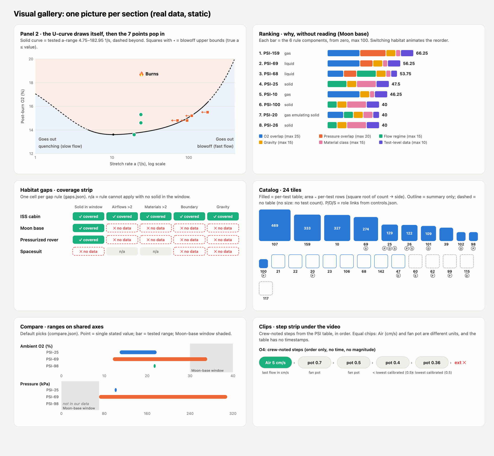

---

## 6. Recommendation

**Direction C, with A's dot bins as the Start hero, built in phases with a hard stop.** C gets most of A's 5-second impact for about a third of the effort and risk, and it keeps every hash, the demo tour and the light-theme assets working.

**Schedule (assuming approval by ~11:00; each phase ends with a preview deploy and the audit re-run):**
1. **Phase 1 – foundation + Start (≈ 2.5 h, to ~13:30).** Tokens, type scale, chip component, 5-section nav with hash compatibility, bottom bar on phones, Start rebuilt (V1 dot bins, V10, ≤ 80 words above the fold).
2. **Phase 2 – Evidence + the two "why" visuals (≈ 2 h, to ~15:30).** V2 hover card and direct labels, V3 Panel 2 draw-on, text into expanders and chips; V4 ranking bars; V5 coverage strip (Gaps, and the Moon row on Controls).
3. **Phase 3 – text diet (≈ 1.5 h, only if Phase 2 lands on time).** Controls, Earth, Clips, Limits (one-line claims + expanders), Ask explainer, Sandbox chips.
4. **QA (≈ 1 h).** Lighthouse ≥ 90 on Start and Evidence, keyboard pass, 1440/375 light/dark audit screenshots (before/after word counts), `demo.mjs` stills, OG image regenerated.

**Hard stops:** Phase 1 alone is mergeable. If Phase 2 is not verified on the preview by **15:30**, merge only Phase 1 (or nothing), so that the demo recording isn't made against a half-styled site. Production only changes after you approve the preview.

**Cut order if time runs short** (first to go first): V8 clip strip → V7 compare bars → V6 catalog tiles → V9 suppressant map → Phase 3 text diet on Earth/Clips → V4 ranking bars. **Never cut:** chips (a source one interaction away), the Limits link on every page, and the reduced-motion end states.

**Honest expected effect.** The biggest gain is Presentation: the site goes from text-first to picture-first on Start, Evidence, Ranking and Gaps, the four tabs a judge is most likely to open. Impact rises because the headline becomes a picture rather than a sentence. Creativity gains a little (dot bins, empty-zone hover). Validity and Relevance do not move; they are already the site's strength, and the plan's job is not to damage them. The 30 s video gains the most, because its stills and the tour come from these pages.

---

## 7. Constraint checklist (applies to every option)

| Constraint | How it is kept |
|---|---|
| No number, source or caveat deleted | Every HIDE item moves into a chip, ⓘ, expander or drawer, verbatim. The audit is re-run after each phase: visible + hidden words per tab must not drop except for duplicates that were removed (Moon/rover; Controls' copy of the gap list, which is replaced by a link to the same sentences) |
| Every number traces to its source in one interaction | The chip rule (sec. 4) + chart tooltips as now; `cite()` stays the single renderer |
| Headline wording | Unchanged template (`web/src/headline.js`), still shared by Start and Evidence |
| No data or pipeline changes | The visuals read existing `data/processed` files only (V7 uses `ranking.json` ranges that already exist). No `scripts/0*` changes |
| Known Limits always present | Header/footer link on every page; About section |
| Accessibility | Roving tabindex kept for sub-tabs; chips are buttons; bins, bars and cells focusable with labels; table views kept; contrast checked (incl. dark zone); reduced motion = end states |
| Lighthouse ≥ 90 | No web fonts, no new libraries (SVG by hand, ECharts as now), lazy tabs kept; measured on the preview |
| Phone first-class | Bottom bar, phone variants of V1 (row layout, mocked) and of every chart; audit at 375 px each phase |
| Branch + previews, main/prod untouched | `ui-overhaul` created; previews via `npx --yes vercel@65.16.0 deploy --yes` (no `--prod`). Preview URLs sit behind Vercel login, so open them while logged in. Merge + `--prod` only after your approval |

## 8. Reproduce

- Audit: `node scripts/shots/audit.mjs <baseURL> docs/ui/audit` → `docs/ui/audit/shots/*.jpg` (gitignored; small copies in `audit/before/` and `audit/after-*/`) + `audit.json`.
- Mockups: `node docs/ui/mockups/build.mjs` → `docs/ui/mockups/mockups.html` + `png/*.png` (reads `data/processed`, renders with system Chrome).
